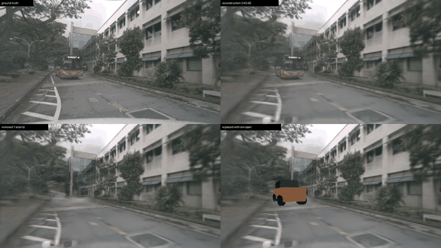

# SimSplat

SimSplat is a standalone 3D Gaussian Splatting workflow for building
**editable scenes for simulation**. It reconstructs a scene as a *scene
graph*: one static Gaussian background plus rigid actors, each with its own
Gaussians and per-frame pose. Any actor can then be hidden, moved, or
replaced by a simulator asset at render time.

It is built directly on [gsplat](https://github.com/nerfstudio-project/gsplat)
and PyTorch, with no Nerfstudio dependency.



**Simulation report:** [Neural rendering for an excavator simulator](results/simulation_report/README.md).
It covers:
- a benchmark on 7 scenes;
- objects rebuilt as MuJoCo assets inside the neural scene;
- a perception sim-to-real check;
- a camera-driven closed loop;
- failure modes, and where neural rendering should replace sim assets.

## Features

- **Scene-graph model.**
  - Static field plus rigid actors stored in their local box frames.
  - Hidden actors keep their Gaussian rows (opacity is zeroed), so
    densification statistics stay aligned.
  - View-dependent colour is evaluated in each actor's own frame.
- **Driving-scene extras.** A learned sky environment map and a per-camera
  colour transform for multi-camera exposure differences.
- **Calibration-aware data.** Every camera keeps its own intrinsics and lens
  model, and is rendered with gsplat's native camera models. Nothing is
  silently resized.
- **One scene format.** Every data source is converted once into a common
  directory layout; the training workflow only reads that format.
- **Editing tools.**
  - Remove or replace actors (`render_edit.py`).
  - Turn meshes into Gaussian assets (`assets.py`).
  - Lift an object out of a static capture from 2D masks
    (`lift_masks_to_actor.py`).
- **Adaptive density control** with a hard Gaussian budget that also keeps
  actor ownership consistent through split/clone/prune.

## How it works

```text
raw dataset ──converter (once)──► scene directory
                                       │
train.py → Trainer → FullImagePipeline ├─ DataManager → InputDataset ← SceneDataParser
                                       └─ SimSplatModel (background + actors, sky, appearance) → gsplat
                                                    │
render_edit.py: hide / replace actors ◄─────────────┘
```

| Package | Responsibility |
| --- | --- |
| `converters/` | Dataset-specific code; writes the scene format (e.g. nuScenes). |
| `data/` | Scene format I/O, parsers, datasets, data managers. |
| `models/` | Gaussian state, actor composition, rendering, losses, metrics. |
| `strategies/` | Budgeted densification that respects actor ownership. |
| `engine/` | Trainer, optimizers, checkpoints, logging. |
| `assets.py` | Mesh → Gaussian surfels for simulator assets. |
| `scripts/` | Command-line entry points. |

## Install

```bash
pip install -e .                 # core: torch, gsplat, pycolmap, ...
pip install -e '.[edit]'         # mesh assets + mp4 export
pip install -e '.[masking]'      # Grounding DINO / SAM masks
pip install -e '.[dev]' && pytest
```

A CUDA GPU is required for training and rendering; the unit tests run on CPU.

## Quick start

```bash
# 1. Convert a dataset into the scene format (once)
python -m sim_splat.scripts.convert_nuscenes --config configs/convert/<scene>.yaml --output data/scenes/<scene>
python -m sim_splat.scripts.convert_colmap   --scene configs/scenes/<colmap_scene>.yaml --output data/scenes/<scene>

# 2. Train
python -m sim_splat.scripts.train --scene configs/scenes/<scene>.yaml --config configs/methods/<method>.yaml

# 3. Evaluate held-out views
python -m sim_splat.scripts.eval --scene ... --config ... --checkpoint outputs/<experiment>/checkpoints/final.pt

# 4. Edit: hide moving actors, replace one with a mesh asset
python -m sim_splat.scripts.render_edit --scene ... --config ... --checkpoint ... \
    --hide moving --replace <track-id-prefix> [--asset-mesh asset.obj] --video --output-dir outputs/edit
```

Configs are split three ways:
- `configs/convert/`: dataset options, used once at conversion time.
- `configs/scenes/`: which scene directory to train on.
- `configs/methods/`: model, optimizer and densification settings.

## Scene format

A scene is a directory; every converter writes it, and `SceneDataParser`
reads it:

```text
<scene>/
├─ scene.json      {"format": "sim_splat_scene", "version": 1, "name": ..., "metadata": {...}}
├─ cameras.json    {"frames": [{image, width, height, K, c2w, camera_model, distortion,
│                               is_rectified, sensor, timestamp, split, mask?}, ...]}
├─ points.ply      binary PLY: float x,y,z · uchar red,green,blue · int track (-1 = static)
├─ tracks.json     optional {"tracks": [{id, category, box_size_xyz, poses: {frame: 4x4}}]}
├─ images/
└─ masks/          optional static masks (white = supervise)
```

- **Cameras:** `c2w` uses the OpenCV camera convention (x right, y down,
  z forward). `K` matches the stored image resolution. `split` is `train`,
  `eval` or `unused`.
- **Actors:** points owned by an actor are stored in that actor's box frame
  (x = length, y = width, z = up). Each track holds one object-to-world pose
  per frame index in which it is present, already interpolated to that
  image's timestamp.
- **World frame:** z-up is preferred; the sky map assumes it.

### Adding a data source

Add a converter, not a parser:

1. Build a `DataparserOutputs` (cameras, images, splits, seed points,
   optional actor tracks) in `converters/<source>.py`.
2. Call `sim_splat.data.scene_format.export_scene(outputs, out_dir, name)`.
3. Add a thin CLI in `scripts/convert_<source>.py` and a YAML in
   `configs/convert/`.

`converters/nuscenes.py` is a complete example covering:
- multiple cameras, plus 12 Hz frames between annotated keyframes;
- LiDAR seeding;
- actor pose interpolation;
- ego-body masks.

## Results

- [Simulation report](results/simulation_report/README.md):
  - scene-0061 work zone with every visible barrier rebuilt as a MuJoCo asset;
  - perception and closed-loop evaluation;
  - a 7-scene fidelity benchmark.
- [nuScenes scene-0916](results/nuscenes_scene0916/README.md): six-camera
  reconstruction (21.6 dB held-out PSNR), plus moving-actor removal and
  sim-asset replacement.
