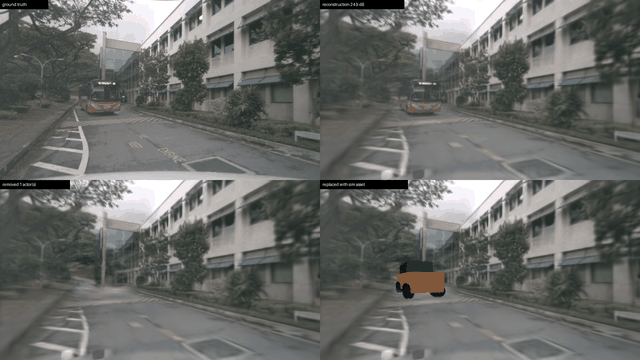
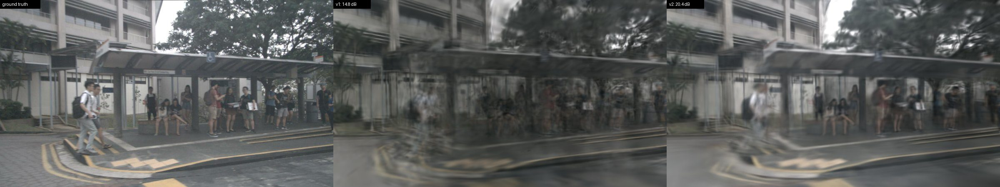
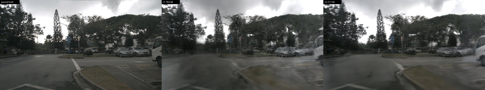
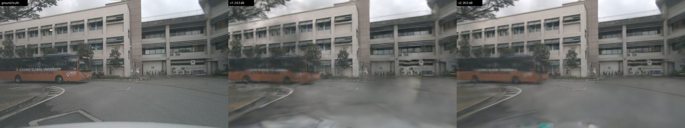
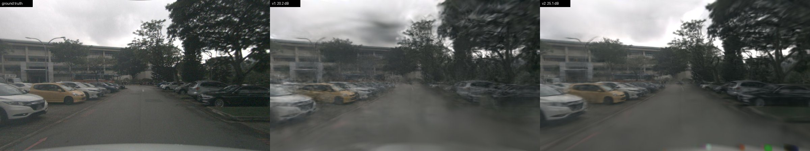
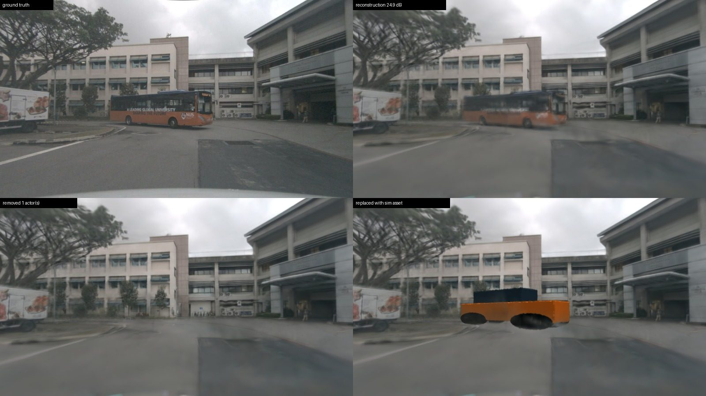
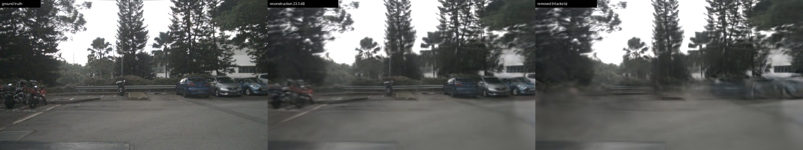

# nuScenes scene-0916: reconstruction and actor editing

This is a parking-lot sequence from nuScenes-mini, covering 20 s with six
surround cameras at 800×450. It contains 94 annotated actors: a moving bus,
parked cars and pedestrians. Each actor is reconstructed as its own rigid
Gaussian node, so it can be removed or swapped for a simulator asset at
render time.



*Panels, left to right and top to bottom: ground truth, reconstruction,
moving bus removed, and bus replaced by a mesh asset that follows its tracked
trajectory.*

## Quantitative: v1 → v2

Both runs use the same model and the same 31 held-out keyframe images. The
only difference is how many training views they get.

| Run | Training views | Steps | PSNR ↑ | SSIM ↑ |
| --- | --- | --- | --- | --- |
| v1: 2 Hz keyframes | 215 | 30k | 18.76 | 0.612 |
| v2: + 6 Hz sweeps, ego-body mask | 695 | 50k | **21.64** | **0.718** |

| Held-out camera | Views | v1 PSNR | v2 PSNR |
| --- | --- | --- | --- |
| CAM_FRONT_LEFT | 11 | 16.47 | 19.27 |
| CAM_FRONT_RIGHT | 10 | 18.33 | 21.50 |
| CAM_BACK | 10 | 21.71 | 24.40 |

v2 is better on every one of the 31 held-out views; per-view numbers are in
[`metrics.json`](metrics.json). Denser capture over time matters more than
training length here: the v1 model was *worse* at 30k steps than at 10k
(19.08 dB), because with 2 Hz keyframes the nearest training view is 0.5 s
away and longer training overfits.

## Qualitative: ground truth | v1 | v2






The strip at the bottom of the CAM_BACK v2 renders is the ego vehicle's
trunk. v2 excludes it from supervision, so it is left unconstrained there.

## Editing

| | |
| --- | --- |
|  | Removing the moving bus reveals the building entrance, shrubs and bike rack behind it, which were observed in frames where the bus was elsewhere. The replacement asset is rendered in the same rasterization pass, so occlusion is consistent. |
|  | Ground truth, reconstruction, and all 94 actors removed. Where a parked car never moved, the ground beneath it was never observed, so removal leaves a blurred smudge instead of road. |

## Limitations

- **No inpainting.** Background that no camera observed (under parked cars)
  cannot be recovered by removal alone; it needs inpainting.
- **Rigid actors.** Pedestrians are modelled as rigid boxes and look blurred.
- **Sparse capture.** Side cameras at low resolution remain the weakest views
  (about 19 dB). Using all 12 Hz sweeps, full resolution and a LiDAR depth
  loss are the next levers.
- **Not comparable to published numbers.** DrivingGaussian-style published
  numbers use full-resolution frames and different splits.

## Reproduce

```bash
python -m sim_splat.scripts.convert_nuscenes --config configs/convert/nuscenes_scene0916_drivinggaussian_sweeps.yaml \
    --output data/scenes/nuscenes_scene0916_drivinggaussian_sweeps
python -m sim_splat.scripts.train --scene configs/scenes/nuscenes_scene0916_drivinggaussian_sweeps.yaml \
    --config configs/methods/nuscenes_scene0916_drivinggaussian_sweeps.yaml
python -m sim_splat.scripts.render_edit --scene configs/scenes/nuscenes_scene0916_drivinggaussian_sweeps.yaml \
    --config configs/methods/nuscenes_scene0916_drivinggaussian_sweeps.yaml \
    --checkpoint outputs/nuscenes_scene0916_drivinggaussian_sweeps/checkpoints/final.pt \
    --replace 8a26f7d3 --split all --channel 3 --video --output-dir outputs/edit_bus
```

v1 uses the `nuscenes_scene0916_drivinggaussian` configs instead. Training
v2 took about 70 minutes on one RTX 3080 Ti.
