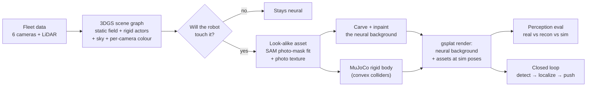

# Neural rendering for an excavator simulator: benchmark, failure modes, recommendation


*A nuScenes work zone (scene-0061) reconstructed with 3D Gaussian splatting. Every clearly visible barrier has been
rebuilt as a simulator asset and rendered back into the neural background. Left: t = 0. Right: a MuJoCo excavator
pushes the joint between two barriers; both move and the rest of the row stays put.*

## TL;DR

- **Fidelity.** On 7 nuScenes scenes the scene-graph model beats vanilla 3DGS by **+2.68 dB PSNR**: 21.35 → 24.03 dB
  mean, better on all 7 scenes.
  - At the same 30k-step budget the gain is +2.87 dB (3 scenes). Rigid actors account for 1.65 dB, the sky model
    for 0.77 and per-camera colour for 0.42; the actors' share ranges from 0.3 to 3.2 dB depending on traffic.
- **Integration.** Reconstructed objects that must be *interactive* are rebuilt as conventional sim assets. Shape
  comes from SAM photo masks and texture from the fleet photos. The assets become MuJoCo rigid bodies and are
  rendered back into the neural background.
  - 21 of the 65 barriers in the work zone are converted. The other 44 are occluded hard cases and are left in
    the background.
- **Does it transfer to autonomy?** Across 370 (view, object) pairs, the detector's outcome on the simulator's
  render matches its outcome on the real photo **90.5%** of the time. The unedited reconstruction matches 92.4%.
  - A camera-driven closed loop (detect → localize → push 1.2 m) ends 4.8 cm from the goal; the oracle-state
    loop ends 5.4 cm away.
  - This takes three fixes for failures that appear only in closed loop.
- **Recommendation.**
  - Use neural rendering for everything the autonomy stack only *looks at*: background, terrain appearance, parked
    equipment.
  - Use photo-textured conventional assets for everything it *touches*.
  - Measure the gap with a downstream detector, not with PSNR alone.

## Pipeline



| Stage | Script |
| --- | --- |
| Reconstruct | `train.py` (scene graph: static field + per-track rigid actors, sky map, per-camera affine colour) |
| Rebuild objects as assets | `build_lookalike_asset.py --category`, checked by `check_assets.py` |
| Remove them from the background | `inpaint_removed.py --asset-root` |
| Simulate | `simulate_excavator.py` (MuJoCo 3, excavator arm with IK + position servos) |
| Render the simulation | `render_physics.py` |
| Measure | `eval.py`, `eval_scene_perception.py`, `closed_loop_push.py` |


*The 21 rebuilt barriers. Panels per asset: photo | reconstruction | asset alone | asset in place. Shape is fitted
from SAM masks on the fleet photos; texture is projected from them.*

## 1. Benchmark

### 1.1 Visual fidelity (held-out views, 7 scenes)

| Scene | PSNR: vanilla 3DGS → ours | SSIM | LPIPS ↓ |
| --- | --- | --- | --- |
| 0061 (work zone) | 20.87 → **23.59** | 0.698 → **0.743** | 0.485 → **0.388** |
| 0103 | 20.12 → **22.91** | 0.714 → **0.750** | 0.502 → **0.397** |
| 0553 | 27.12 → **29.83** | 0.937 → **0.946** | **0.084** → 0.088 |
| 0655 | 20.59 → **23.01** | 0.750 → **0.780** | 0.475 → **0.378** |
| 0757 | 22.53 → **26.68** | 0.771 → **0.822** | 0.354 → **0.254** |
| 0796 | 18.26 → **20.54** | 0.550 → **0.587** | 0.748 → **0.638** |
| 0916 | 19.99 → **21.64** | 0.675 → **0.717** | 0.516 → **0.401** |
| **Mean** | 21.35 → **24.03** | 0.728 → **0.763** | 0.452 → **0.363** |

**Equal-budget ablation.** The table above compares a 50k-step model with 30k-step vanilla 3DGS, and four changes
at once. Here every model gets the vanilla budget: 30k steps, densification until 15k. One component is removed at
a time. PSNR on held-out views; *static* means pixels outside annotated objects.

| Scene | vanilla 3DGS | full (30k) | − rigid actors | − sky | − per-camera colour | full (50k) |
| --- | --- | --- | --- | --- | --- | --- |
| 0061 | 20.87 | **23.15** | 22.85 (−0.30) | 22.54 (−0.62) | 21.87 (−1.28) | 23.59 |
| 0553 | 27.12 | 29.65 | 28.21 (−1.45) | 28.54 (−1.12) | **30.17 (+0.51)** | 29.83 |
| 0757 | 22.53 | **26.34** | 23.14 (−3.20) | 25.76 (−0.59) | 25.84 (−0.50) | 26.68 |
| **Mean** | 23.51 | **26.38** | 24.73 (−1.65) | 25.61 (−0.77) | 25.96 (−0.42) | 26.70 |

- **At equal budget the gain is +2.87 dB**, so it is not an artefact of longer training (the extra 20k steps add
  0.32 dB).
- **The three components roughly add up** (1.65 + 0.77 + 0.42 = 2.84 dB).
- **Rigid actors matter most, but per scene.** They are worth 3.2 dB in 0757 (heavy traffic) and only 0.3 dB in the
  parked work zone 0061. Most of that gain is in *static* pixels (0757 static PSNR 27.67 vs 24.38): without actors,
  moving cars smear floaters across the road that every view sees.
- **Per-camera colour can hurt.** In 0553 (overcast, cameras consistent) it costs 0.5 dB. The affine transform
  absorbs some view-dependent appearance that should stay in the Gaussians. In 0061 (low sun) it is worth 1.3 dB.

### 1.2 Temporal consistency and speed

TBD.

### 1.3 Does fidelity transfer to perception?

The scenes are scored with an off-the-shelf open-vocabulary detector:
- **Detector:** Grounding DINO tiny, run on the full frame plus tiles.
- **Ground truth:** the visible boxes of the 21 rebuilt barriers.
- **Images compared:**
  - *real*: the fleet photo;
  - *reconstruction*: the unedited 3DGS render;
  - *sim*: the inpainted background plus all assets, as the simulator renders it.

| 348 views, 370 (view, object) pairs | real | reconstruction | sim |
| --- | --- | --- | --- |
| Recall @IoU 0.3 | 27.6% | 21.1% | 25.4% |
| Recall @IoU 0.5 | 14.1% | 8.1% | 11.1% |
| Same outcome as on the real photo | — | 92.4% | **90.5%** |
| Sim gap: detected on real, missed in render | — | 6.8% | **6.2%** |
| Row of barriers boxed as one object | 84% | 92% | 93% |
| Depth-localization error, median | 0.47 m* | 0.45 m | 0.31 m |

\* The photo has no depth, so it uses the reconstruction's depth as a LiDAR stand-in.


*The main sim gap, panels photo | reconstruction | sim (green: ground truth, red: detections). On the photo the
detector boxes the orange barrier alone (IoU 0.81). On both renders it merges it with the neighbour, because the
dark seam between abutting barriers is softer.*

Renderers of different fidelity on the same views (vanilla 3DGS, ablations): TBD.

### 1.4 Closed loop

- **Task:** push the barrier 1.2 m and leave it upright.
- **Each cycle:**
  1. render the simulator view;
  2. detect the barrier;
  3. localize it from depth;
  4. command the bucket.

**Setup:**
- **Scene:** the inpainted background, all 21 barrier assets, and the simulated neighbours.
- **Observation camera:** one fleet camera (view 195).
- **Detector:** Grounding DINO tiny.

Each perception or control fix was added one at a time, so every row isolates the failure it addresses.

| Controller input | Result | Final error | What happened |
| --- | --- | --- | --- |
| Oracle state (simulator truth) | ✅ 2 pushes | 5.4 cm | — |
| Camera, as first written | ❌ toppled | — | Depth sees the near face: the estimate is 0.24–0.47 m ahead, so the bucket comes down *on* the barrier |
| + surface → centre correction | ❌ lost track | — | Detector boxes the whole row as one: no detection near the last estimate |
| + 0.5 m clearance before lowering | ⚠ ends in tolerance, never converges | 5.3 cm | Estimate stays 0.21 m ahead, oscillates until max cycles |
| + predicted-box gating | ❌ toppled | — | Tracks the right unit; the 0.23 m bias remains, and the 0.15 m gap is too small |
| gating + clearance | ❌ stops short | 22 cm | Bias makes it think the goal is reached |
| **gating + clearance + centre** | ✅ **2 pushes** | **4.8 cm** | Perception error 3.4 cm, same as the oracle |

How each fix works:
- **Predicted-box gating:** project the last estimate with the known object size, pick the detection that covers
  that box, and clip a merged row-box to it.
- **Clearance:** lower the bucket farther behind the object than the perception error.
- **Surface → centre:** move the depth point by half the object's depth along the ray.

No single fix is enough. The two perception failures, a biased depth point and merged boxes, only show up in
closed loop, and the controller has to be robust to the error that remains.

| Camera as first written: barrier toppled | All three fixes: tracked unit, 3 cm error |
| --- | --- |
|  |  |

## 2. Failure modes found, and fixes

Each of these was found by a measurement, not by eye alone.

| Failure | Found by | Fix | Effect |
| --- | --- | --- | --- |
| Static objects are baked into the background: the barrier's own actor Gaussians are transparent (12 of 6011 opaque) | inspection | Rebuild as an asset instead of moving Gaussians | — |
| Rendered depth around off-road objects is a blur along viewing rays | `check_assets` flags + side-view point plots | Fit shape from SAM photo masks across views | Sanity checks passed: 5 of 65 → 21 built, 0 flagged. The first barrier had been 25% too short |
| nuScenes per-frame poses drift up to ±0.3 m in height | spread of mask edges between views | Per-frame height correction, used by every renderer | — |
| Blotchy textures: background and pedestrians in the samples | contact sheet | Sample inside the photo mask and reject what disagrees with the static render | Photo-textured surface 17% → 34% |
| A vehicle parked in front gets baked into the texture | contact sheet | Skip objects whose views disagree on height (IQR > 15 cm) | 44 hard cases left in the background |
| The asset shows through a half-transparent veil | strict crop PSNR + a green-asset test | Inpainting: only Gaussians *behind* the asset learn the fill | Hidden pixels 27–48% → 4–11% |
| Neighbours start sunk in or floating (±21 cm) and pop at t = 0 | idle-control simulation | Snap simulated bodies to the ground; render only their simulated *motion* on the photo-fitted pose; shrink annotation colliders; 1 s settle | Idle drift 6–9 cm → ~1e-10 m |
| Closed loop topples the barrier, loses it, or stops short | closed loop vs oracle (§1.4) | Predicted-box gating + 0.5 m clearance + surface → centre | Fail → 4.8 cm, oracle 5.4 cm |
| Wrong prompt: the whole row (and the excavator) boxed as "road barrier" | closed loop | Prompt "an orange plastic barrier." | — |
| Rendered panel captioned "original scene" | demo GIF | Variable shadowing in `render_physics` | — |

### Construction-specific challenges: status

| Challenge | Status |
| --- | --- |
| Dynamic objects | Done: per-track rigid actors; moving actors removed or replaced |
| Harsh lighting | *Partly.* Lighting is baked into the Gaussians and the assets, so pushed assets keep their original shading and cast no new shadow. The missing contact shadow between abutting barriers is the main remaining perception gap (row merging 93% vs 84%) |
| Deformable terrain | Not yet. Plan: a MuJoCo height field under the bucket, with ground Gaussians displaced by the same field |
| Dust | Not yet. Plan: participating-medium Gaussians or screen-space dust, evaluated by detector degradation against real dusty frames |

## 3. Recommendation: where neural rendering should (and should not) replace sim assets

1. **Background and anything only observed: neural.** It is the only practical way to get real-site appearance, and
   it is cheap to update from fleet logs. Detector outcomes on reconstructions match the real photos 92% of the time.
2. **Anything the machine touches: conventional assets textured from the same fleet photos.** Gaussians baked into
   the background cannot move. Static objects are never separated from it, so they must be rebuilt.
   - Simulation needs collision geometry and mass, which the reconstruction does not provide.
   - Mixing the two costs little: 90.5% vs 92.4% agreement.
3. **Occluded or ambiguous objects: leave them neural.** The pipeline should detect when it cannot build a
   faithful asset (here, disagreement between views) rather than guess.
4. **Physics and rendering need different truths.** Physics needs a consistent world, and rendering needs alignment
   with each photo. Keep them separate and apply simulated *motion* to photo-aligned poses.
5. **Measure with the downstream task.** PSNR ranks renderers, but the gap that matters showed up only in detector
   behaviour: rows merged into one box, and depth that is too clean.

## 4. Limitations

- **The detector is a weak proxy.** Grounding DINO tiny is open-vocabulary, has low recall even on real photos, and
  merges rows of barriers. A driving-trained 3D detector would be the real test.
- **Lighting is baked.** There are no relighting, cast shadows or time-of-day changes.
- **The excavator is untextured boxes.** Its appearance is not part of the evaluation.
- **One work zone.** The scene is a road work zone from nuScenes, not an excavation site.

## Reproduce

```bash
S=configs/scenes/nuscenes_scene0061_sweeps.yaml; M=configs/methods/nuscenes_scene0061_sweeps.yaml
python -m sim_splat.scripts.train --scene $S --config $M
python -m sim_splat.scripts.build_lookalike_asset --scene $S --config $M --checkpoint <ckpt> --category movable_object.barrier --surfels 40000 --output-dir <assets>
python -m sim_splat.scripts.check_assets <assets>
python -m sim_splat.scripts.inpaint_removed --scene $S --config $M --checkpoint <ckpt> --asset-root <assets> --output-dir <bg>
python -m sim_splat.scripts.eval_scene_perception --scene $S --config $M --checkpoint <ckpt> --background-checkpoint <bg>/final.pt --asset-root <assets> --max-views 400 --output-dir <out>
python -m sim_splat.scripts.simulate_excavator --scene $S --track 808a988e --asset-dir <assets>/808a988e --asset-root <assets> --push-sign -1 --lateral-offset 1.0 --asset-mass 60 --travel 1.6 --seconds 6 --output push.pt
python -m sim_splat.scripts.render_physics --scene $S --config $M --checkpoint <bg>/final.pt --physics push.pt --asset-root <assets> --views 79 85 109 --skip-depth --output-dir <render>
```
